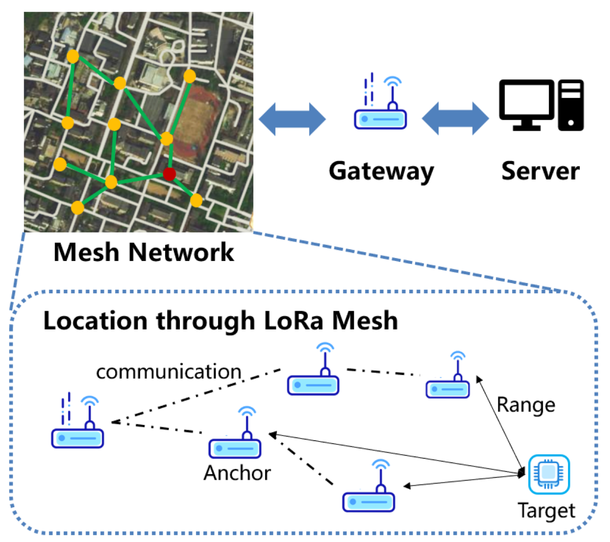

# Architecture Decision Record (ADR)

## 1. Decision: Full-Stack Architecture vs. Frontend-Only Mock

### Decision
We decided to build a complete full-stack application using **Node.js/Express** for the backend and a **PostgreSQL** database (via Drizzle ORM) rather than relying solely on React state. 

### Consequences
*   **Positive:** The application acts as a true digital twin. The backend can independently process network failures, calculate Dijkstra routing autonomously, and safely manage Cisco Webex and xAI API keys without exposing them to the client.
*   **Negative:** Increased complexity in deployment and local development setup compared to a static frontend site.

---

## 2. Decision: Dijkstra's Algorithm for Mesh Routing

### Context
In disaster scenarios, physical infrastructure often fails unpredictably. The mesh network must dynamically self-heal and find the optimal path for SOS messages to reach the Meraki Cellular Gateway, taking into account varying latency and node availability.

### Decision
We implemented **Dijkstra's Shortest Path Algorithm** on the backend to actively compute the optimal route between any two active nodes based on simulated link latency and distance.

### Consequences
*   **Positive:** Guarantees the mathematically shortest/fastest route for critical emergency data. When a node is marked "offline", the algorithm instantly drops those edges and recalculates, perfectly demonstrating network resilience.
*   **Negative:** Dijkstra scales at $O(V^2)$. Highly performant for our simulated grid, but a massive real-world deployment would require an optimized heuristic approach like A* or AODV.

---

## 3. Decision: Simulating vs. Real Implementations (Hardware & API)

### Context
The solution requires demonstrating Cisco-powered connectivity (Meraki) and advanced integrations. Given the constraints of a software hackathon, deploying physical Meraki MG52 cellular gateways and physical LoRa radios to a field test was not viable.

### Decision
We elected to draw a strict line between what is simulated in software and what uses real API integrations:

**Simulated Components:**
*   **Physical Mesh Links:** LoRa and Bluetooth physical layer connections are mocked via our Node.js routing engine. The diagram below illustrates the intended real-world hardware topology that our software simulates:
    
    
*   **Cisco Hardware:** The Cisco Meraki MG52 Gateway is simulated as a virtual node ("cisco-gateway") in the database that acts as the mesh-to-cloud uplink.

**Real Components:**
*   **Cisco Webex API:** We use real Webex Bot Tokens and Webhooks to push live markdown alerts to an actual Webex Crisis Room.
*   **xAI Grok API:** We hit the real Grok API (`api.x.ai`) to generate live, context-aware AI situation summaries for SOS emergencies.
*   **Web Crypto API:** We use actual browser-native cryptography (ECDSA P-256 and AES-256-GCM) for E2EE rather than faking security.

### Consequences
*   **Positive:** Allows us to quickly demonstrate the workflow of Cisco technology and AI integration without hardware dependencies, while proving our software integration chops with real external APIs.

---

## 4. Decision: Cross-Platform Mobile App via Flutter & Dart

### Context
Disaster victims will be using mobile phones, not web dashboards, to connect to the mesh network. We needed a way to demonstrate the end-user experience accurately.

### Decision
We built a separate Mobile App (housed in the `/mobile/appDisas` directory) using **Flutter and Dart** alongside the web dashboard. The mobile app provides a sandboxed configuration mode where the user points the app to the local Node.js mesh gateway IP, as well as a zero-dependency offline local sandbox fallback.

### Consequences
*   **Positive:** Proves the viability of the system for actual end-users. Judges can see the flow of a message originating on a real phone, traveling through the simulated mesh, and arriving in a Webex room. By using Flutter, we achieve high-performance 60fps rendering, custom canvas visuals, and smooth tactical animations.
*   **Negative:** Requires maintaining two distinct codebases (Web UI and Mobile UI) during a tight hackathon timeline.
