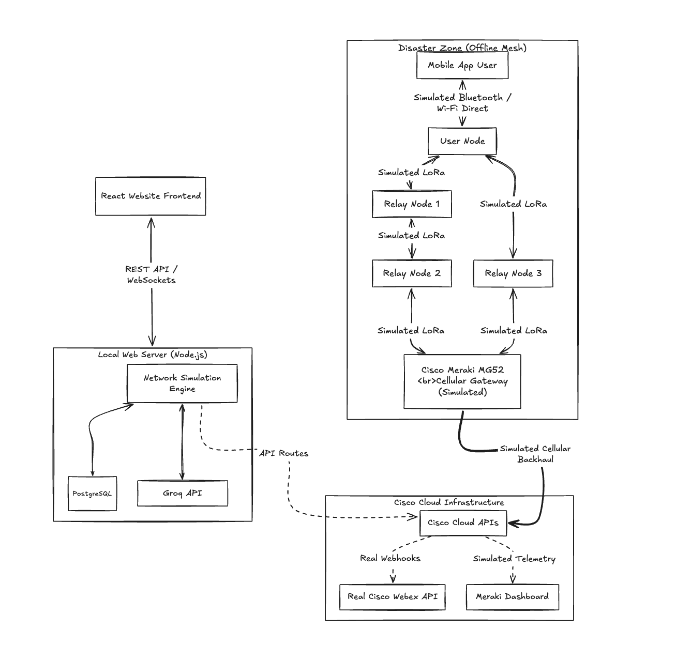
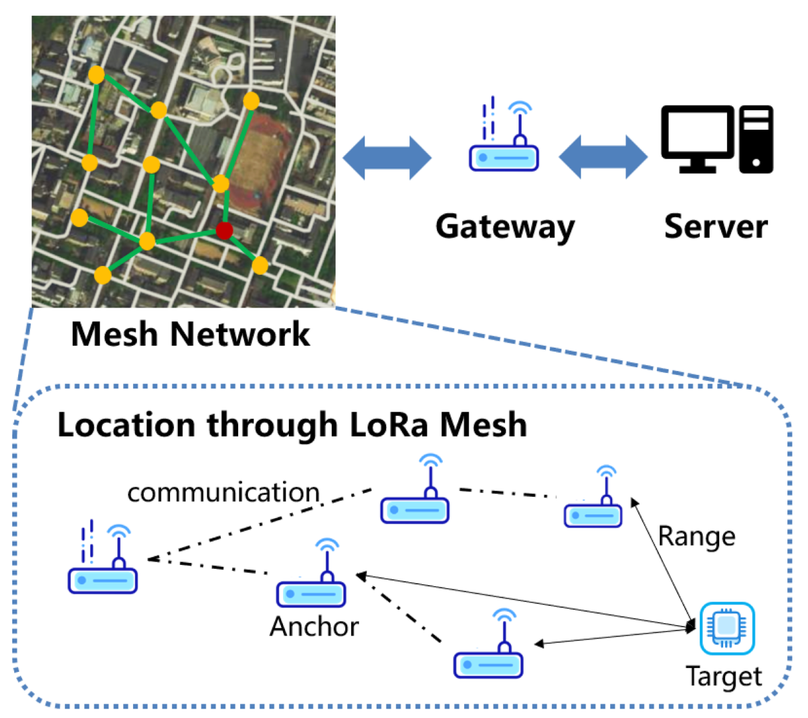
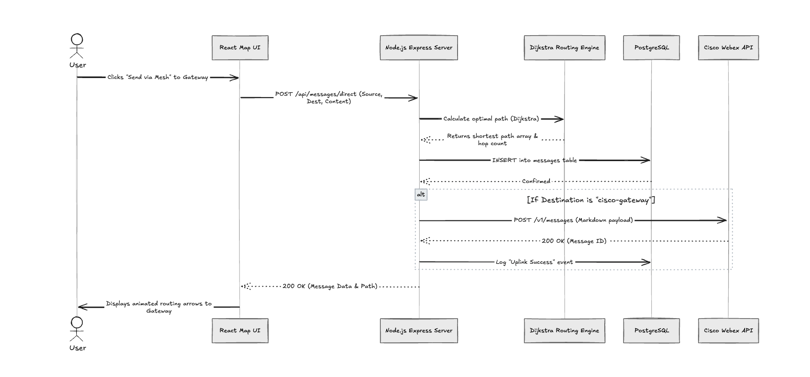
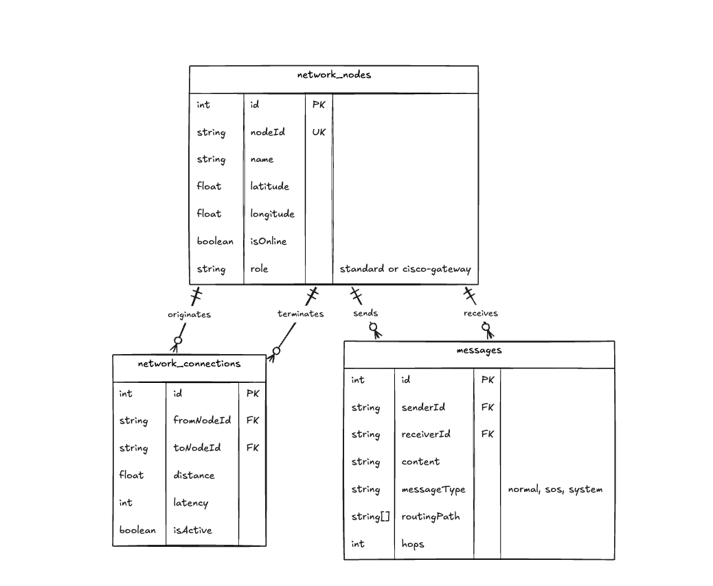

# Architecture Diagrams & Tech Stack

The following diagrams and documentation illustrate the architecture, technology stack, workflows, and database schema for the Disaster Network Simulator.

## 1. High-Level Component Architecture

This diagram shows how the offline mesh network (including the mobile app) interacts with the simulated Cisco Meraki gateway to uplink critical data to the cloud.

---

## 1.5 Physical Hardware Topology (Real-World Application)

While the hackathon demonstration utilizes a Node.js routing engine to simulate node connectivity, the real-world application is designed to utilize long-range LoRa hardware. Below is the physical mesh topology illustrating how Anchor nodes and Target nodes communicate to triangulate location and route data to the Cisco Gateway.

---

## 2. Comprehensive Tech Stack

### 🌐 Website Tech Stack (Dashboard & Simulation UI)
- **Framework**: React 18, TypeScript, Vite
- **Styling**: Tailwind CSS, Shadcn UI
- **Mapping**: Mapbox GL JS (Real-time tracking and pulsing markers)
- **State Management**: React Query
- **Cryptography**: Native Web Crypto API (In-browser ECDSA P-256 and AES-256-GCM)

### 📱 Mobile App Tech Stack (End-User Interface)
- **Framework**: React Native / Expo (Cross-platform Android/iOS)
- **Networking**: Local Network APIs for connecting to the mesh gateway Sandbox mode
- **UI/UX**: Native components for emergency SOS triggering and encrypted messaging

### ⚙️ Backend Tech Stack (Mesh Engine & API)
- **Runtime**: Node.js & Express.js
- **Database**: PostgreSQL (Neon Serverless)
- **ORM**: Drizzle ORM for type-safe SQL
- **Routing Algorithm**: Custom implementation of Dijkstra’s Algorithm for dynamic mesh routing

### ☁️ Cisco Integrated Tech Stack & External APIs
- **Real Integration**: Cisco Webex API (Bots & Webhooks for crisis room alerts)
- **Real Integration**:  Groq API (LLM generation for SOS situation summaries)
- **Simulated Hardware**: Cisco Meraki MG52 Cellular Gateway (Telemetry and uplink mock)
- **Simulated Hardware**: LoRa / Bluetooth Mesh Nodes (Physical transmission is mocked via WebSocket/HTTP state)

---

## 3. Emergency SOS Routing & Uplink Workflow

This sequence diagram illustrates what happens when a user triggers an SOS alert from the mobile app, hitting the mesh network, generating an AI summary, and arriving at the Webex crisis room.

---

## 4. Database Entity Relationship (ER) Diagram

